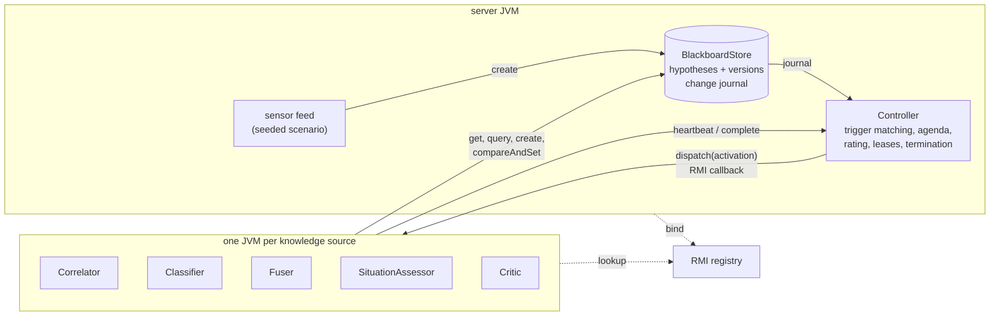

# blackboard-rmi

A distributed blackboard system: independent knowledge sources running in separate JVMs cooperate through a shared, versioned blackboard over Java RMI, under an opportunistic control scheduler.


## What it demonstrates

- **Hierarchical blackboard** for multi-sensor situation assessment: `RAW_DETECTION -> TRACK -> OBJECT -> SITUATION`. Every hypothesis carries a belief in [0, 1], typed attributes and support links to the hypotheses it was derived from, so any conclusion can be traced down to the sensor reports behind it.
- **Optimistic concurrency between processes**: every hypothesis has a version, updates are compare-and-set on that version, and a read-modify-write helper re-applies the mutation after a conflict. Writes that change nothing are suppressed (no version bump, no event), which is what lets the system reach a fixed point.
- **Knowledge sources as remote processes**: Correlator (detections to tracks), Classifier, Fuser (tracks to objects), SituationAssessor (rule-based, objects to situations) and Critic (lowers the belief of inconsistent hypotheses). Each one declares its precondition as data (trigger patterns on level, event type and tags) and is notified through an RMI callback.
- **Opportunistic control**: a totally ordered change journal is matched against trigger patterns; matching events are coalesced into activation records on an agenda and rated by expected belief gain over measured cost, with a focus-of-attention boost and aging. Termination is quiescence (input closed, agenda empty, nothing in flight, board quiet), a deadline or an activation budget.
- **Failure handling**: workers hold leases renewed by heartbeat. A silent worker is declared dead, its in-flight activation goes back on the agenda and is re-executed elsewhere; late results from a zombie are ignored. Knowledge-source actions are idempotent so at-least-once delivery is safe.
- **Seeded synthetic scenario** (three sensors with different accuracy, missed detections, about 40 % clutter, and a coherent single-sensor false target) plus a ground-truth reference that applies the same rule base to true states, so the end-to-end result is checked rather than eyeballed.

## Architecture



The overall shape is the classic blackboard architecture from speech-understanding research: a shared, leveled store of competing hypotheses, independent knowledge sources that only communicate through it, and a separate control component that decides which knowledge source to run next. What this lab adds is the distribution: knowledge sources in separate processes, optimistic concurrency instead of a single scheduler thread, and failure detection.

The blackboard and the controller live in one server process and are exported as RMI remote objects. Each knowledge source runs in its own JVM, looks both up in the registry, registers its trigger patterns with the controller and exports a callback object. The controller reads the journal directly, matches new events against every registered pattern, and dispatches the best-rated activation record to an idle worker of the right type. The worker reads and writes the blackboard itself (compare-and-set) and reports the outcome; its writes produce new journal events, which trigger the next round. The levels are processed in parallel and out of order: tracks are being refined while objects already exist and situations are being re-evaluated.

| Package | Role |
|---|---|
| `core` | `Hypothesis`, `BlackboardService` (remote API), `BlackboardStore`, CAS loop, change events |
| `control` | `TriggerPattern`, `KsSpec`, `Agenda` and rating, `Controller`, `LeaseTable`, `KsRuntime` (worker host) |
| `ks` | the five knowledge sources |
| `domain` | object classes, kinematics, belief composition, situation rule base |
| `scenario` | seeded generator, sensors, feeder |
| `app` | CLI (`--local`, `registry`, `server`, `worker`), report, ground-truth scoring |

## Quickstart

Requires JDK 21. No third-party runtime dependencies.

```bash
# Dependency-free build and tests (javac + jar + in-repo test runner)
scripts/build.sh

# Same tests under Maven / JUnit 5 (what CI runs first)
mvn -B test

# Everything in one JVM, still over RMI (in-process registry)
java -jar build/blackboard-rmi.jar --local --seed 7
java -jar build/blackboard-rmi.jar --local --seed 7 --fault   # second Correlator hangs mid-activation

# Distributed: registry, server and 6 worker JVMs on localhost for about 10 s.
# One extra Correlator halts its JVM with an activation in flight.
scripts/demo.sh            # options: --seed N --duration S --no-fault

# Inspect a scenario and its expected situations from ground truth
java -jar build/blackboard-rmi.jar scenario --seed 7
```

The demo prints the final blackboard state (objects with fused class, belief, contributing sensors and critique; situations with status, version and support), the comparison with ground truth, an excerpt of the activation trace including the lease expiry and the reassigned activation, and per-knowledge-source counters. Excerpt:

```
Objects:
  id               class      conf belief sensors   critique                     truth
  O/S2/00/01       FASTBOAT   1.00  0.300 S2        uncorroborated               G1
  O/S2/00/03       AIRCRAFT   1.00  1.000 S1,S2,S3  ok                           A2
  ...
Situations:
  ACTIVE    belief 0.950 v16  S/FORMATION/O/S2/00/03+O/S2/00/07                support [O/S2/00/03(A2), O/S2/00/07(A1)]
  ACTIVE    belief 0.850 v48  S/RENDEZVOUS/O/S2/00/00+O/S2/00/08               support [O/S2/00/00(V1), O/S2/00/08(B1)]
  RETRACTED belief 0.000 v7   S/ZONE_INCURSION/O/S2/00/01                      support [O/S2/00/01(G1)]
  ACTIVE    belief 0.900 v41  S/ZONE_INCURSION/O/S3/00/07                      support [O/S3/00/07(A3)]

  3008 ms  LEASE_EXPIRED Correlator        Correlator-2          no heartbeat for 1200 ms, worker removed
  3008 ms  REQUEUED      Correlator                     #6       RAW_DETECTION/S1   24 trigger(s) back on agenda
  3008 ms  DISPATCHED    Correlator        Correlator-1 #6/a2    RAW_DETECTION/S1   r=0.187  24 trigger(s), focus OBJECT
  ...
 10021 ms  TERMINATED    QUIESCENT, agenda 0, in flight 0, journal 1406
```

`#6/a2` is activation record 6 on its second attempt: Correlator-2 accepted it and then its JVM halted, so it was requeued when the lease lapsed and completed on Correlator-1.

The `truth` column and the `(A1)` style labels come from the evaluation code, which follows support links down to the raw detections and looks up the generator's labels. Knowledge sources never see labels.

## Design decisions

1. **Blackboard rather than a message bus or actors.**
   *Decision:* knowledge sources share one versioned store of hypotheses and are scheduled by a central controller, instead of publishing to topics or messaging each other as actors.
   *Why:* the problem is incremental, multi-level and opportunistic. A situation rule needs the current state of every credible object, not a stream of deltas, and the Critic needs to annotate hypotheses that someone else owns. With a message bus each consumer would rebuild its own copy of the picture and the copies would drift; with actors, the "who should work next" decision is spread across mailboxes and nobody can trade off a cheap high-gain step against an expensive low-gain one. A shared board with provenance plus a controller that sees all pending work gives one consistent picture and one place for scheduling policy.
   *Trade-off:* the board and the controller are a single point of failure and a throughput ceiling. That is acceptable for analytical workloads measured in hundreds of hypotheses per second; it would not be for a high-volume event pipeline, where a partitioned log is the better fit.

2. **Optimistic concurrency with component-owned beliefs.**
   *Decision:* updates are compare-and-set on the hypothesis version, wrapped in a loop that re-applies a pure mutation to the fresh value. Belief is not written directly: it is `base x (1 - penalty)`, where `base` is owned by the deriving source and `penalty` by the Critic, and every writer recomputes it.
   *Why:* locks held across RMI calls are fragile when a worker can die mid-call, and knowledge sources rarely touch the same hypothesis at the same instant. Splitting belief into owned components is what makes the retry loop correct: when the Fuser refreshes an object the Critic has just penalised, the retry keeps the penalty instead of overwriting it (there is a test for exactly that interleaving).
   *Trade-off:* under heavy contention the loop retries, and a mutation has to be written as a function of the current value rather than as a blind write. Writers also have to round derived values, otherwise floating-point noise defeats the no-op suppression.

3. **Triggers as data, evaluated centrally against a journal.**
   *Decision:* a knowledge source declares its preconditions as serializable `TriggerPattern`s at registration. The controller keeps one journal cursor per knowledge-source type and matches events itself, instead of pushing every change to every worker.
   *Why:* workers only receive work they will act on, a knowledge source type that joins late replays the journal from the start, and a replacement worker after a crash needs no state hand-over. Coalescing events per (knowledge source, context) turns 30 detection events into one Correlator activation per sensor and keeps the agenda small.
   *Trade-off:* preconditions are limited to what the pattern language can express (level, event type, tag equality, own-write filter). Anything richer has to be checked inside the action, which costs a dispatch when it turns out to be a no-op.

4. **Rating = expected belief gain / measured cost, with focus and aging.**
   *Decision:* each activation record is rated by its declared gain, the uncertainty of the triggering hypotheses and the amount of coalesced evidence, divided by an exponentially weighted moving average of the knowledge source's measured execution time. Records at the level that changed last get a focus boost; waiting records age upward.
   *Why:* this is the opportunistic part: cheap, informative steps run first, and the search tends to follow fresh results upward (a new track quickly becomes an object and then a situation) instead of finishing one level before starting the next. Measured cost makes the policy self-tuning across machines; aging bounds starvation.
   *Trade-off:* the rating is a heuristic. It does not change *what* the system concludes (actions are deterministic functions of board state, and the run continues to a fixed point), only how fast it gets there and in what order.

5. **Leases and at-least-once execution instead of exactly-once.**
   *Decision:* a worker holds a lease renewed by heartbeat. When it lapses, or a dispatch callback fails, or an activation runs past a timeout, the activation record goes back on the agenda with the same id and an incremented attempt number, merged with any newer triggers for the same context. A result reported for a superseded attempt is ignored.
   *Why:* exactly-once across processes needs a transaction coordinator. At-least-once plus idempotent actions is much simpler: natural keys make `create` idempotent (track ids derive from the detection that started them), the Correlator skips detections already in a track, and every other action recomputes from current state.
   *Trade-off:* a zombie worker can still write before it notices it lost its lease. Its writes are valid derivations of the board state it read and go through CAS, so they are harmless here, but a system with side effects outside the board would need fencing tokens.

6. **Partitioning by context to serialise order-sensitive work.**
   *Decision:* a trigger pattern can name a context tag. The controller allows one pending and one running activation per (knowledge source, context): the Correlator is partitioned by sensor, the Classifier by sensor, the Fuser and the object-level sources run as a single partition.
   *Why:* scan-by-scan association is order sensitive within one sensor but independent across sensors, so this gives parallelism where it is safe and serial execution where it is required, without locks in the knowledge sources.
   *Trade-off:* a global partition (Fuser) caps that source at one activation at a time. Coalescing compensates (one activation absorbs everything that arrived while the previous one ran), but a much larger picture would need a spatial partition key.

## Scope and limits

- One blackboard server. There is no replication of the board or the controller; losing the server loses the run.
- No persistence. The journal is in memory and grows without compaction.
- RMI uses default Java serialization over plain TCP on localhost, with no authentication or TLS. It is not meant to be exposed on a network.
- The tracker is an alpha-beta filter with greedy gated association, not a full multiple-hypothesis tracker. The classifier is naive Bayes on two features. They are deliberately simple; the point is the coordination between them.
- The situation rules (formation, zone incursion, rendezvous) are a small fixed rule base in code, not a rule engine.
- Scheduling is evaluated by convergence and trace inspection, not by benchmarks against other policies.

## About this lab

A compact reference implementation written in 2026. It reconstructs, on synthetic data, patterns I have used in production systems (shared-state coordination of independent analytic components, optimistic concurrency, opportunistic scheduling and lease-based failure recovery), without reproducing any proprietary design.

## License

MIT, see [LICENSE](LICENSE).
